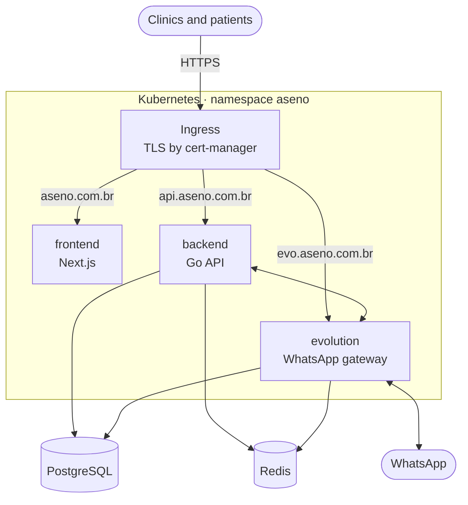
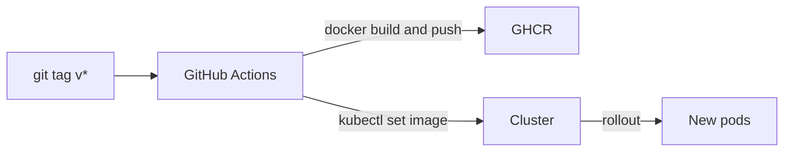

<div align="center">

# Aseno — Infrastructure

**Kubernetes manifests that run Aseno in production.**

A lean, single-cluster setup for a SaaS that serves clinics: web app, API and a self-hosted WhatsApp gateway, all behind automatic HTTPS.


</div>

---

## Overview

This repository describes how the Aseno platform runs in production. It ties together the
[frontend](https://github.com/aseno-up/frontend), the [backend](https://github.com/aseno-up/backend)
and [Evolution API](https://github.com/EvolutionAPI/evolution-api), the WhatsApp gateway that the
AI agent uses to talk to patients.

## Architecture



| Domain | Service | Purpose |
|--------|---------|---------|
| `aseno.com.br` | frontend | Clinic dashboard, booking pages and marketing site |
| `api.aseno.com.br` | backend | REST API, webhooks and the WhatsApp AI agent |
| `evo.aseno.com.br` | evolution | WhatsApp connection for each clinic |

## What is in here

```
namespace.yaml          the aseno namespace
ingress.yaml            routing by domain, TLS for all hosts
cluster-issuer.yaml     Let's Encrypt issuer for cert-manager (HTTP-01)
backend/                API deployment and service
frontend/               web app deployment and service
evolution/              WhatsApp gateway deployment and service
caddy/                  alternative edge proxy with automatic HTTPS
```

## Design choices

- **Small footprint.** Every workload has tight resource requests and limits, so the whole platform
  fits on a single small node and costs little to run.
- **Health checks.** The API has startup, readiness and liveness probes, so a bad release never
  receives traffic and a stuck pod restarts on its own.
- **Automatic HTTPS.** cert-manager issues and renews Let's Encrypt certificates for every domain.
  Caddy is kept as a lighter alternative edge with built-in HTTPS.
- **No secrets in Git.** All credentials come from a single Kubernetes Secret (`aseno-secrets`),
  created out of band and never committed.
- **Private images.** Images are pulled from GitHub Container Registry with a pull secret.

## Delivery flow



Each application repository deploys itself: pushing a version tag builds the image, publishes it
and updates the matching deployment here, waiting for the rollout to finish.

## Applying

```bash
kubectl apply -f namespace.yaml
kubectl apply -f cluster-issuer.yaml

# credentials (not in this repository)
kubectl -n aseno create secret generic aseno-secrets --from-env-file=.env.production
kubectl -n aseno create secret docker-registry ghcr-secret \
  --docker-server=ghcr.io --docker-username=<user> --docker-password=<token>

kubectl apply -f backend/ -f frontend/ -f evolution/
kubectl apply -f ingress.yaml
```

---

<div align="center">
Built by <a href="https://github.com/jhamiltonjunior">Hamilton Santos</a>
</div>
